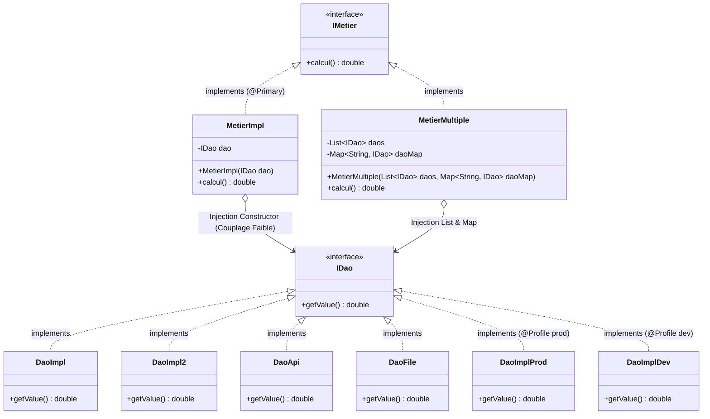

# 🛒 ShopMaster E-Commerce — Spring IoC & Principe OCP (Open-Closed Principle)

Projet de travaux pratiques (TP) personnalisé et approfondi sur l'**Inversion de Contrôle (IoC)** avec **Spring Framework** et l'application stricte du **principe OCP (Open-Closed Principle)** du modèle SOLID.

---

## 📌 1. Thématique Métier : Calcul de Panier & Remises Omnicanales

Dans cette version personnalisée, l'architecture illustre une plateforme e-commerce moderne (**ShopMaster**) capable de récupérer les montants des commandes et paniers clients depuis plusieurs sources de données hétérogènes :

| Composant DAO | Source E-Commerce | Montant Brut HT | Rôle / Environnement |
| :--- | :--- | :--- | :--- |
| `DaoImpl` | **Base PostgreSQL de Production** | `100.00 €` | Source par défaut en production (`dao.target=dao`) |
| `DaoImpl2` | **Base H2 Locale (Sandbox)** | `150.00 €` | Environnement développeur (`dao.target=dao2`) |
| `DaoApi` | **API REST Stripe / Checkout Gateway** | `220.00 €` | Passerelle de paiement en temps réel (`dao.target=daoApi`) |
| `DaoFile` | **Fichier local `commandes_offline.csv`** | `180.00 €` | Commandes différées / mode déconnecté (`dao.target=daoFile`) |
| `DaoImplProd` | **Cluster Haute Disponibilité Prod** | `100.00 €` | Activé sous le profil Spring `@Profile("prod")` |
| `DaoImplDev` | **Base Mock Dev** | `150.00 €` | Activé sous le profil Spring `@Profile("dev")` |

Le service métier `MetierImpl` applique la logique de tarification et marge commerciale (calcul TTC x2.0) **sans JAMAIS dépendre d'une classe concrète**.

---

## 🏗️ 2. Diagramme d'Architecture et Conception



---

## 🎯 3. Justification du Principe OCP (Open-Closed Principle)

Le principe OCP stipule qu'une entité logicielle doit être :
- **Fermée à la modification** : Le code source de [MetierImpl.java](file:///c:/Users/elamr/.gemini/antigravity/scratch/Tp9/TP3-2/src/main/java/metier/MetierImpl.java) n'a subi **aucune modification**, qu'on utilise la base SQL, l'API Stripe, un fichier CSV ou un cluster de production.
- **Ouverte à l'extension** : Pour brancher un nouveau système (ex: `DaoKafka` ou `DaoShopify`), il suffit de créer une nouvelle classe implémentant [IDao.java](file:///c:/Users/elamr/.gemini/antigravity/scratch/Tp9/TP3-2/src/main/java/dao/IDao.java) et de l'annoter avec `@Component`. Le conteneur Spring IoC se charge de l'injecter.

---

## ⚖️ 4. Tableau Récapitulatif des Stratégies Comparées

| Stratégie | Avantages | Inconvénients | Cas d'Usage Idéal |
| :--- | :--- | :--- | :--- |
| **`@Primary`** | Simple, intuitif, résout immédiatement l'ambiguïté pour Spring. | Statique : nécessite de modifier le code ou de recompiler pour changer le bean par défaut. | Définir une implémentation principale évidente. |
| **`@Bean Alias`** | Centralisé dans une classe `@Configuration`, très lisible. | Reste codé en dur en Java, nécessite recompilation pour rediriger. | Remplacement ou wrapper d'une bibliothèque tierce. |
| **Propriétés Externes (`app.properties`)** | **La plus flexible** : basculement à chaud sans recompiler le projet (via `dao.target`). | Erreurs de typage ou de clé détectées seulement à l'exécution si non typé. | **Production et DevOps** (variables d'environnement, microservices). |
| **Profils Spring (`@Profile`)** | Séparation propre et native par environnement (`dev`, `prod`, `test`). | Moins granulaire pour un changement dynamique à la volée en cours d'exécution. | Gestion des configurations multi-environnements (CI/CD). |

---

## 🧩 5. Extension : Injection Multiple (`List` et `Map`)

La classe [MetierMultiple.java](file:///c:/Users/elamr/.gemini/antigravity/scratch/Tp9/TP3-2/src/main/java/metier/MetierMultiple.java) démontre la puissance de l'injection par collection de Spring :
```java
@Service
public class MetierMultiple implements IMetier {
    private final List<IDao> daos;
    private final Map<String, IDao> daoMap;

    public MetierMultiple(List<IDao> daos, Map<String, IDao> daoMap) {
        this.daos = daos;
        this.daoMap = daoMap;
    }
    
    @Override
    public double calcul() {
        return daos.stream().mapToDouble(IDao::getValue).sum();
    }
}
```
Spring injecte automatiquement :
1. **Tous les beans** de type `IDao` dans la `List<IDao>`.
2. **Tous les beans** indexés par leur nom de composant (`"dao"`, `"dao2"`, `"daoApi"`, `"daoFile"`) dans la `Map<String, IDao>`.

Cela permet une **consolidation omnicanale** complète du chiffre d'affaires.

---

## 🧪 6. Tests de Non-Régression JUnit

Les tests automatisés sont situés dans `src/test/java/test/` :

1. **[OcpSelectionTest.java](file:///c:/Users/elamr/.gemini/antigravity/scratch/Tp9/TP3-2/src/test/java/test/OcpSelectionTest.java)** :
   - `testDaoImplParDefaut()` : Vérifie que lorsque `dao.target=dao`, la valeur calculée est exactement `200.0`.
   - `testConformiteArchitecturaleOcp()` : Valide que `MetierImpl` est découplé et injecté avec succès.
2. **[ProfileSelectionTest.java](file:///c:/Users/elamr/.gemini/antigravity/scratch/Tp9/TP3-2/src/test/java/test/ProfileSelectionTest.java)** :
   - `testProfilProduction()` : Active le profil `prod` et valide le résultat `200.0`.
   - `testProfilDeveloppement()` : Active le profil `dev` et valide le résultat `300.0`.
3. **[MetierMultipleTest.java](file:///c:/Users/elamr/.gemini/antigravity/scratch/Tp9/TP3-2/src/test/java/test/MetierMultipleTest.java)** :
   - `testInjectionCollectionsDaos()` : Valide l'injection de la liste et de la map avec les 4 canaux de vente.

---

## 🚀 7. Guide d'Exécution

### Lancer tous les tests unitaires :
```bash
mvn test
```

### Exécuter la démonstration interactive complète :
```bash
mvn compile exec:java "-Dexec.mainClass=Main"
```

### Modifier la source sans toucher au code Java :
Éditez simplement [src/main/resources/app.properties](file:///c:/Users/elamr/.gemini/antigravity/scratch/Tp9/TP3-2/src/main/resources/app.properties) :
```properties
dao.target=daoApi
```
Puis relancez l'application ! Le montant passe immédiatement à `440.00 €` sans aucune recompilation du code métier.
